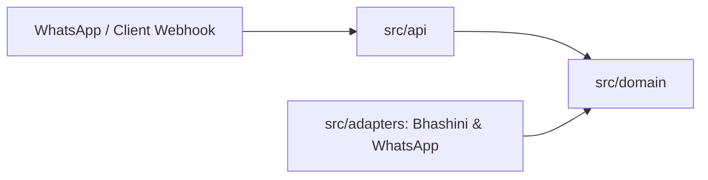

# Architecture Map

## 1. Context
- **System**: Bhashini Sovereign Multilingual AI Service — Enables vernacular voice, speech-to-text (ASR), translation (NMT), text-to-speech (TTS), and messaging integration (WhatsApp Cloud API / Web endpoints) using India's sovereign AI infrastructure (Digital India Bhashini Division / MeitY).
- **Upstream systems**: Bhashini ULCA / Dhruva inference API gateways (REST & WebSocket protocols), Meta Graph API / WhatsApp Business Webhook (HTTP POST events).
- **Downstream systems**: End users on messaging channels (WhatsApp), web clients, regional advisory business engines.
- **Runtime**: Python 3.12+, FastAPI, Uvicorn, HTTPX async client, Pydantic, FFmpeg for audio transcoding.

## 2. Module map
| Module / folder | Concern (one) | Notes |
|---|---|---|
| `src/domain/` | Multilingual & business domain models | Pure: speech intents, translation models, domain rules (no I/O or frameworks) |
| `src/adapters/bhashini/` | Bhashini ULCA & Dhruva API client | Manages dynamic auth handshake, ASR, NMT, and TTS pipeline execution |
| `src/adapters/whatsapp/` | WhatsApp Business & Cloud API client | Inbound webhook verification, media downloading, outgoing text & voice dispatch |
| `src/adapters/audio/` | Audio transcoding adapter | Converts OGG Opus audio stream to 16kHz mono 16-bit PCM WAV via FFmpeg |
| `src/api/` | API routing and endpoints | Webhook routes, health check, background task scheduling |

## 3. Domain ownership (engineering invariant INV-1)
| Domain | Owning module | Rules document | Owner (team/person) |
|---|---|---|---|
| Multilingual Speech & Translation | `src/domain/speech_translation/` | `docs/rules/SPEECH_TRANSLATION_RULES.md` | Core AI Team |
| WhatsApp & Messaging Integration | `src/domain/messaging/` | `docs/rules/MESSAGING_RULES.md` | Platform Team |
| Business Advisory & Intent Engine | `src/domain/business_engine/` | `docs/rules/BUSINESS_ENGINE_RULES.md` | Domain Lead |

A rule belongs to exactly one domain. If you cannot find the owner, stop and ask — do not create a second home.

## 4. Dependency rules (enforced by the `architecture-rules` check)
- `api` → `domain` ← `adapters`.
- `domain` must not import `api`, frameworks, HTTP clients, or database drivers.
- Modules talk to another domain only through its public interface (`__init__.py` public symbols).
- External network requests to Bhashini and WhatsApp must only be performed inside `src/adapters/`.

## 5. Contracts and data
- APIs: FastAPI OpenAPI schema (`/docs` or `/openapi.json`).
- Messaging contracts: Meta WhatsApp Cloud API v21.0 payload structures.
- Bhashini pipeline contracts: ULCA `getModelsPipeline` config and inference endpoint schema.
- Data classification: Citizen voice and message transcripts treated with strict privacy (transient memory processing, zero plain-text disk logging of secrets).

## 6. Cross-cutting
- Logging: Python `logging` with structured formatting (`%(asctime)s [%(levelname)s] %(message)s`).
- Errors: `HTTPException` at API boundary, domain exceptions in core.
- Config: Environment variables managed via `pydantic-settings` / `python-dotenv`.
- Security: Sovereign execution on verified endpoints, bearer token authorization, no API keys committed.

## 7. Where does new code go? (quick decision guide)
1. A business rule → the owning domain module (section 3). New domain? Write an ADR first.
2. Talking to an external service (Bhashini, WhatsApp, S3, FFmpeg) → an adapter in `src/adapters/`.
3. A new endpoint or route → `src/api/`.
4. Shared utilities → only after a second real use (INV-2), in `src/shared/`.

## 8. Diagram

