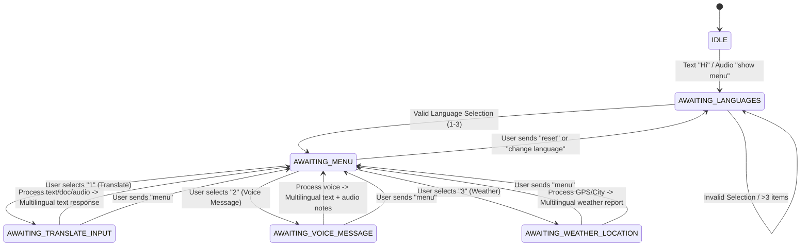

# Data Model & State Machine: WhatsApp Multilingual Bot

**Feature**: `001-whatsapp-multilingual-bot`  
**Date**: 2026-10-11

---

## 1. Domain Entities

### `UserSession`
Represents the conversational state for a distinct WhatsApp sender phone number.

```python
from dataclasses import dataclass, field
from datetime import datetime, timezone
from enum import Enum
from typing import List, Optional


class SessionState(str, Enum):
    IDLE = "IDLE"
    AWAITING_LANGUAGES = "AWAITING_LANGUAGES"
    AWAITING_MENU = "AWAITING_MENU"
    AWAITING_TRANSLATE_INPUT = "AWAITING_TRANSLATE_INPUT"
    AWAITING_VOICE_MESSAGE = "AWAITING_VOICE_MESSAGE"
    AWAITING_WEATHER_LOCATION = "AWAITING_WEATHER_LOCATION"


class SupportedLanguage(str, Enum):
    ENGLISH = "en"
    HINDI = "hi"
    TELUGU = "te"
    BENGALI = "bn"
    TAMIL = "ta"
    KONKANI = "gom"  # Konkani Bhashini code


@dataclass
class UserSession:
    phone_number: str
    state: SessionState = SessionState.IDLE
    selected_languages: List[str] = field(default_factory=list)
    last_interaction: datetime = field(default_factory=lambda: datetime.now(timezone.utc))
```

---

## 2. State Machine Transitions



---

## 3. Interaction Models

### `IncomingMessage`
- `sender_id`: String (e.g. `919876543210`)
- `message_id`: String
- `message_type`: `text` | `audio` | `document` | `location`
- `text_content`: Optional[str]
- `media_id`: Optional[str]
- `latitude`: Optional[float]
- `longitude`: Optional[float]

### `WeatherForecastData`
- `location_name`: str
- `current_temp_max`: float
- `current_temp_min`: float
- `current_condition`: str
- `tomorrow_temp_max`: float
- `tomorrow_temp_min`: float
- `tomorrow_condition`: str
- `rain_expected`: bool
